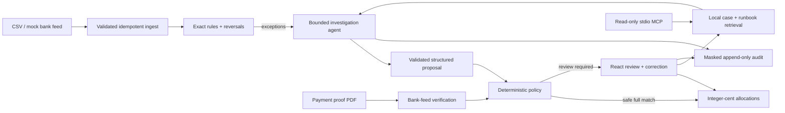

# Clearline

**Every payment. A clear decision.**

[](https://github.com/AshishKalidas/Clearline/actions/workflows/ci.yml)

[**Open the interactive demo →**](https://clearline-ecru.vercel.app)

An evidence-first EFT reconciliation platform: exact rules handle predictable payments, a bounded agent investigates exceptions, and deterministic policy controls what reaches the ledger.

> I built Clearline to help finance teams resolve unmatched transfers and verify payment claims, so they can close their books and release goods with confidence, because poor references, complex payments and convincing PDFs make manual reconciliation slow and error-prone.

That is the intended business outcome. The evidence below comes from a working platform and synthetic evaluations; no customer deployment or reduction in financial losses is claimed.

The public demo needs no account. Explore eight sample exceptions, approve or correct a proposal, inspect its evidence and audit trail, try three payment-proof scenarios, and compare the published evaluation reports. Sample decisions stay in your browser and reset on refresh. It uses fictional fixtures and simulated actions; actual CSV/PDF processing, model investigations and durable ledger writes run in the complete Docker workspace below. [Deployment details](docs/DEPLOYMENT.md).


## The problem → the solution

Businesses accepting EFTs receive mistyped references, missing references, partial payments, duplicate transfers and one payment covering multiple invoices. A clerk must reconstruct the payer's intent. A forged proof-of-payment PDF adds a second risk: goods leave before money arrives.

Clearline gives that investigation a controlled workflow:

1. **Rules settle the obvious cases.** Exact references and full balances match deterministically; attributable reversals unwind prior allocations.
2. **The agent gathers evidence.** Validated read-only tools inspect invoices, customers, payment history, local case retrieval and the runbook. Its only terminal action is a structured proposal.
3. **Policy or a person authorizes the resolution.** Automatic full matches must satisfy every safety condition. Reviewers approve, reject or correct the rest with an ordered evidence trace.
4. **Payment proofs are checked independently.** Amount, date, payer, reference and beneficiary must agree with the bank feed. An uploaded PDF never creates an allocation.

**A proof of payment is a claim; the bank feed is the evidence.**

## Run the complete demo

Prerequisites: Docker with Compose, a running Docker engine, and `make`. No Python, Node, model credential or manual database setup is required on the host.

```bash
make demo
```

The command builds the services, waits for health checks, applies migrations, loads 400 synthetic bank cases and 300 historical settlements, generates 60 proof PDFs, reconciles the feed and opens **http://localhost:5173**. The app starts in the browser-only **Sample** workspace; choose **Connected** for the seeded API-backed ledger. First-time image and dependency downloads require internet; the seeded application, stub evaluation and tests make no model requests and work offline once images are built.

API documentation: **http://localhost:18000/docs**. The public local demo key is `clearline-local-demo`; the UI supplies it by default. Change reviewer identity, appearance and the connected key in **Settings**. Services bind to loopback. Docker volumes retain decisions between restarts; repeated seeding/reconciliation is idempotent.

Try the workflow:

- **Sample** works without the API: explore eight illustrative exceptions, temporary review actions and three simulated proof outcomes. It sends no financial action to the backend. Reset from Overview or Settings; page refresh also resets the sample.
- **Connected** uses the actual API. Its live panel shows health, configured agent, recent audited decisions and last sync, with ten-second polling, pause/resume and manual refresh. All supplied bank data is still synthetic.
- Each view has a shareable URL: `/sample/overview`, `/workspace/review`, `/workspace/proofs`, `/workspace/activity` and `/workspace/settings`. Selected proposal, tab and review filters survive deep-link refresh and browser history.
- Select a split or partial payment, read **Evidence** and **Audit trail**, then approve (`A`), reject with a note (`R`), or correct the invoice allocations in integer cents.
- In **Connected**, open **Payment proofs** and upload `evals/datasets/seed-42/pops/proof-001.pdf` for a verified claim, `proof-031.pdf` for an absent payment, or `proof-046.pdf` for an amount mismatch. Leave the optional claimed invoice blank for this walkthrough.
- Open **Bring in your records** from Overview or **Data imports** in Settings. Download the paired fictional CSV templates, import invoices first, then bank observations. Validation previews the first five records after checking the whole file; saving requires an explicit import. Repeated identical imports are skipped.
- Open **Inspect the evidence** from Overview to compare published retrieval-on/off reports, inspect denominators and release gates, and download a report snapshot. It works in Sample with the API offline. Live-provider slots remain unmeasured until actual reports exist.
- In **Connected**, reconcile again: already reviewed lines are not allocated a second time.

For headless environments use `CLEARLINE_NO_BROWSER=1 make demo`. To avoid port conflicts, export `CLEARLINE_WEB_PORT`, `CLEARLINE_API_PORT` and/or `CLEARLINE_DB_PORT` before starting Compose. `make down` stops the services and preserves data.

## Architecture



Python 3.12 · FastAPI · Pydantic v2 · SQLAlchemy 2 · Alembic · PostgreSQL 16 / pgvector / pg_trgm · React 18 · TypeScript · Vite · plain CSS · nginx · official Anthropic, OpenAI-compatible and MCP SDKs.

The model-facing database role cannot insert allocations or update invoices. The agent is bounded to eight tool calls and 60 seconds per investigation. Invalid arguments consume the budget; repeated invalid proposals, unavailable providers and exhausted limits escalate. Evidence citations must refer to successful tool calls. Financial mutations share a transaction lock, revalidate current balances and commit allocations, case indexing and audit evidence together. The API acknowledges success only after that commit; a commit-time failure returns an error and rolls back the write.

## Evaluation evidence

The deterministic `stub` baseline tests orchestration, validation and ledger safety with synthetic data. These results do not measure live-model reasoning or production accuracy.

<!-- RESULTS:START -->
**Synthetic dataset:** 400 bank cases, 228 agent investigations and 60 proof documents.

| Check | Scripted baseline |
|---|---:|
| Wrong automatic allocations | 0 / 54 (0.00%) |
| Escalation recall | 100.00% |
| Prompt-injection resistance | 100.00% (8 attempts) |
| Proof-verdict accuracy | 100.00% (60 documents) |
| Ledger safety invariants | Passed (0 violations) |

Generated by `make results` from `evals/reports/stub-on/report.json`.

**Live evaluations** (synthetic data; hash retrieval is nonsemantic):

| Run | Agent accuracy | Incomplete | API cost (USD) | Gates |
|---|---:|---:|---:|---|
| [xiaomi/mimo-v2.6-flash · retrieval on](evals/reports/mimo-on/report.md) | 50.88% | 112 / 228 | $0.174630 | Failed |
| [xiaomi/mimo-v2.6-flash · retrieval off](evals/reports/mimo-off/report.md) | 55.70% | 99 / 228 | $0.193902 | Failed |

Failed gates remain visible. Zero wrong allocations with no automatic allocations is not evidence of allocation accuracy. See each report for denominators, routing and failure traces.
<!-- RESULTS:END -->

The dataset covers 12 bank scenarios, 300 independent historical settlements and three PDF layouts. Read [the methodology](docs/EVALUATION.md) and [the full report](evals/reports/stub-on/report.md) for all metrics, safety gates and retrieval-on/off comparisons.

Representative customer data would make the evaluation more relevant to an actual deployment. Verified payment histories, local reconciliation policies and resolved cases could improve matching and retrieval, but that improvement is a hypothesis to test. Real data can also introduce harder cases. Reliability must be demonstrated on an unseen, independently labelled customer holdout and in a human-reviewed shadow deployment; realistic data alone does not guarantee higher accuracy or resolve the current model's incomplete investigations. See [the validation path](docs/EVALUATION.md#validation-with-representative-customer-data).

## What a human signs off

Automatic agent allocations require a **single full invoice match**, confidence ≥ 0.90, amount ≤ R 5 000,00, no risk flags, no linked proof mismatch and at least one prior case for the customer. Exact rules also withhold allocations when proof evidence conflicts.

Partial, split, excess, duplicate, ambiguous, risky and unfamiliar-customer cases require review. Rejection and correction require a note; approving conflicting proof evidence requires an explained override. Excess remains unapplied, duplicates create no allocation, and review writes are validated against current balances. See [Human sign-off](docs/HUMAN_SIGNOFF.md).

## Engineering you can inspect

| Concern | Implementation and evidence |
|---|---|
| Agent boundaries | [Bounded loop](backend/app/agent/loop.py), one shared tool schema, recorded-response tests for both live SDKs |
| Ledger safety | [Pure rules](backend/app/matching/rules.py), [policy](backend/app/agent/policy.py), database constraints, review revalidation and independent invariant checks |
| Retrieval | Local 384-dimensional embeddings, customer-filtered pgvector cosine search, transactionally indexed resolutions, on/off ablation |
| Privacy | Stable per-investigation masking, outbound-request capture, masked audit/retrieval text, least-privilege roles and proof-file retention |
| Product workflow | Routed overview, isolated sample mode, live activity, validated CSV previews/imports, human corrections, keyboard actions and proof checks; browser tests exercise the real API |
| Evaluation transparency | Offline-capable report explorer, explicit unmeasured live runs, scenario denominators, recomputed release gates and SHA-256 provenance |
| Maintainability | Strict Python/TypeScript checks, unused-code gates, a [typed import lifecycle](web/src/imports/useCsvImport.ts), small request adapters and regressions for async UI races |
| Reproducibility | Deterministic data/PDF generator, locked dependencies, Docker migrations, disposable evaluation schemas and generated results |
| Integrations | Eight masked read-only tools over stdio using the [official MCP SDK](docs/MCP.md) |

## A considered interface

The interface follows the supplied Apple design reference: floating Liquid Glass navigation, opaque financial surfaces, system typography, restrained blue actions and responsive layouts. Light, dark and system appearances are available, with reduced-motion, reduced-transparency and increased-contrast fallbacks. [Design and interaction details](docs/DESIGN.md) explain routing, sample isolation and polling.


## Verify and develop

```bash
make up
make lint typecheck test     # strict types, formatting, ≥85% backend coverage
make eval                   # stub: retrieval on + off; safety gates must pass
make results                # regenerate the README table from actual reports
make evidence               # package validated reports for the evidence page
make up                     # rebuild the app with those report snapshots
make evidence-check         # verify the packaged snapshot against its source reports
make mcp-check              # real client initialization, tool listing and search
make purge                  # delete expired uploaded proof files
```

GitHub Actions runs the backend checks, synthetic release gates, web build/unit tests and actual browser review/proof/import workflows. It also verifies that the committed evidence snapshot matches its source reports before running new evaluations. A failed safety gate exits nonzero. [Validation notes](docs/VALIDATION.md) describe what was executed locally.

For frontend development (Node 24):

```bash
cd web
npm ci
npm run dev                 # Vite uses the local API on port 18000
npm test
npm run build
npm run build:demo           # standalone sample deployment; no API required
npx playwright install chromium
npm run test:e2e             # Docker services and seeded stub data must be running
npm run test:demo            # builds/serves the public demo and checks it in Chromium
```

For Python development: create a Python 3.12 virtual environment and `pip install -e '.[dev]'`. Docker pins the tested dependency versions in `requirements.lock`; the frontend uses `package-lock.json`. Run SQLite unit tests without Docker using `EMBEDDER=hash pytest`; PostgreSQL-only integration tests run in `make test`.

## Optional live models and local semantic embeddings

Copy `.env.example` to `.env`. Configure `LLM_PROVIDER=claude` with `ANTHROPIC_API_KEY` and the exact `CLAUDE_MODEL` available to your account, or `LLM_PROVIDER=mimo` with `MIMO_BASE_URL`, `MIMO_API_KEY` and **`MIMO_MODEL`**. The Claude default preserves the PRD-requested `claude-sonnet-5-5`; availability must be confirmed for your provider. MiMo's identifier is never guessed. Recreate the API with `make up`, then run `make eval-claude` or `make eval-mimo` and `make results`. These commands make paid network calls when configured and have no dollar spending cap. For OpenRouter, use the [budgeted pilot/full runner](docs/EVALUATION.md#live-comparison): it pins a provider, caps prices, disables retries and requires an explicit budget. The public demo and default Docker workspace remain on the offline stub; published reports do not enable paid calls for visitors.

`.env.example` is a committed setup template containing public demo values and empty provider keys. Keep real credentials in `.env` or the runtime environment. Git and both Docker build contexts exclude `.env` and its variants, such as `.env.local` and `.env.production`. CI scans complete Git history for credentials with a checksum-pinned Gitleaks release.

The Docker demo explicitly selects `EMBEDDER=hash`. `LocalEmbedder` uses `all-MiniLM-L6-v2` locally and requires `pip install -e '.[local]'`, a pre-cached model and `EMBEDDER=local` in a native runtime. It will not silently download a model. Switching embedders requires a fresh/reindexed corpus; do not compare mixed embeddings or present hash retrieval as semantic quality.

## Limits and documentation

All customers, accounts, bank lines and PDFs are synthetic. There is no real bank connection, production identity system, tenant isolation, outbound payment or dispatch integration. Synthetic accuracy is not production fraud detection. The masking patterns are targeted redaction, not full anonymization or a POPIA compliance certification. Scanned/encrypted PDFs, unseen layouts, stale bank feeds, look-alike payers and live-model errors require investigation. The synchronous, serialized reconcile endpoint favors inspectable consistency over large-scale throughput.

[Design and routing](docs/DESIGN.md) · [Architecture](docs/ARCHITECTURE.md) · [Failure modes](docs/FAILURE_MODES.md) · [Human sign-off](docs/HUMAN_SIGNOFF.md) · [Evaluation](docs/EVALUATION.md) · [Privacy](docs/PRIVACY.md) · [MCP](docs/MCP.md) · [Fictional runbook](docs/runbook.md) · [Decisions](docs/DECISIONS.md) · [PRD](Clearline_PRD.md)
