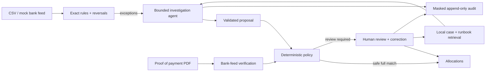

# Clearline

**Evidence-first EFT reconciliation. An agent investigates; policy controls the ledger.**

Clearline helps finance teams resolve unmatched EFT payments and verify payment claims so they can close their books and release goods with evidence, because messy references and convincing PDFs should not decide what reaches the ledger.

## The problem

Businesses accepting bank transfers receive incorrect references, partial payments, duplicate transfers and payments covering several invoices. Finance staff investigate these exceptions by hand. Meanwhile, a forged proof-of-payment PDF can convince dispatch to release goods before any money arrives.

## The solution

Clearline matches exact payments with rules, gives a bounded agent read-only investigation tools, and routes its structured proposals through a deterministic policy. Reviewers receive the evidence, rationale and audit trace. Proofs are checked against actual bank lines.

**A proof of payment is a claim; the bank feed is the evidence.**

This is a synthetic-data engineering demonstration, not a production bank integration or a claim of business results.



## Quick start

Python 3.12, PostgreSQL 16 + pgvector, FastAPI, React 18 + TypeScript. Docker is the default runtime.

```bash
make demo
```

The complete demo and measured evaluation results are added as the milestones pass. Live providers are opt-in and require your own credentials.

<!-- RESULTS:START -->
Evaluation has not yet run.
<!-- RESULTS:END -->
