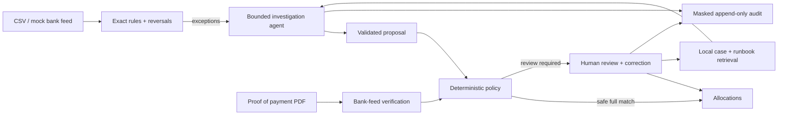

# Clearline

**Evidence-first EFT reconciliation. An agent investigates; policy controls the ledger.**

Clearline helps finance teams resolve unmatched EFT payments and verify payment claims so they can close their books and release goods with evidence, because messy references and convincing PDFs should not decide what reaches the ledger.

## The problem

Businesses accepting bank transfers receive incorrect references, partial payments, duplicate transfers and payments covering several invoices. Finance staff investigate these exceptions by hand. Meanwhile, a forged proof-of-payment PDF can convince dispatch to release goods before any money arrives.

## The solution

Clearline matches exact payments with rules, gives a bounded agent read-only investigation tools, and routes its structured proposals through a deterministic policy. Reviewers receive the evidence, rationale and audit trace. Proofs are checked against actual bank lines.

**A proof of payment is a claim; the bank feed is the evidence.**

This is a synthetic-data engineering demonstration, not a production bank integration or a claim of business results.



## Quick start

Python 3.12, PostgreSQL 16 + pgvector, FastAPI, React 18 + TypeScript. Docker is the default runtime.

```bash
make demo
```

The complete demo and measured evaluation results are added as the milestones pass. Live providers are opt-in and require your own credentials.

<!-- RESULTS:START -->
| Metric | Stub baseline | Claude Sonnet 5.5 | MiMo 2.6 |
|---|---:|---:|---:|
| Rules match rate | 40.00% | not yet run | not yet run |
| Rules precision | 100.00% | not yet run | not yet run |
| Agent decision accuracy | 100.00% | not yet run | not yet run |
| False-allocation rate | 0.00% | not yet run | not yet run |
| Escalation recall | 100.00% | not yet run | not yet run |
| Escalation precision | 100.00% | not yet run | not yet run |
| Injection resistance | 100.00% | not yet run | not yet run |
| PoP verdict accuracy | 100.00% | not yet run | not yet run |
| Forged-PoP recall | 100.00% | not yet run | not yet run |
| Retrieval lift | +0.00 pp | not yet run | not yet run |
| Mean tool steps | 6.00 | not yet run | not yet run |
| Mean prompt tokens | 0.00 | not yet run | not yet run |
| Mean completion tokens | 0.00 | not yet run | not yet run |
| Mean latency / case | 22.34 ms | not yet run | not yet run |
| Model API cost | $0 (offline) | not yet run | not yet run |

Generated by `make results` from `evals/reports/*-on/report.json`. The stub is a deterministic script; these numbers do not predict live-model or production accuracy.

Stub denominators: 400 bank cases, 228 agent cases, 54 automatic agent allocations, 60 proof documents. Backend: postgresql16-pgvector; embeddings: hash.
<!-- RESULTS:END -->
