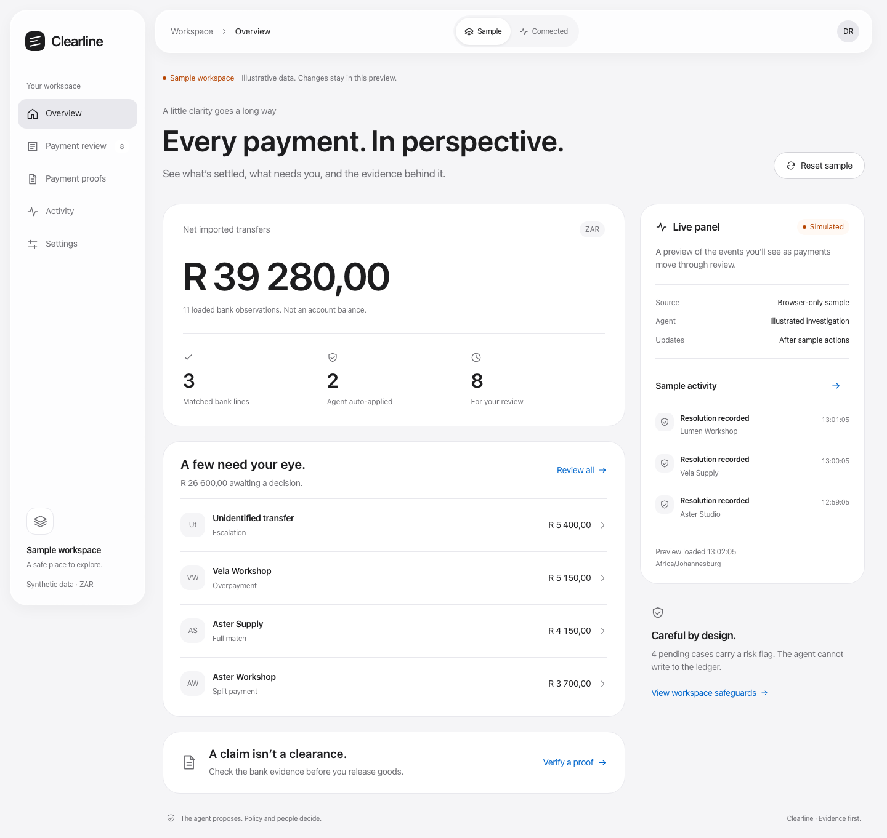
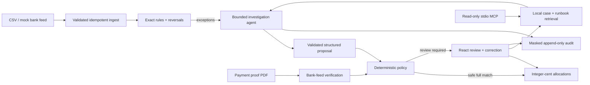
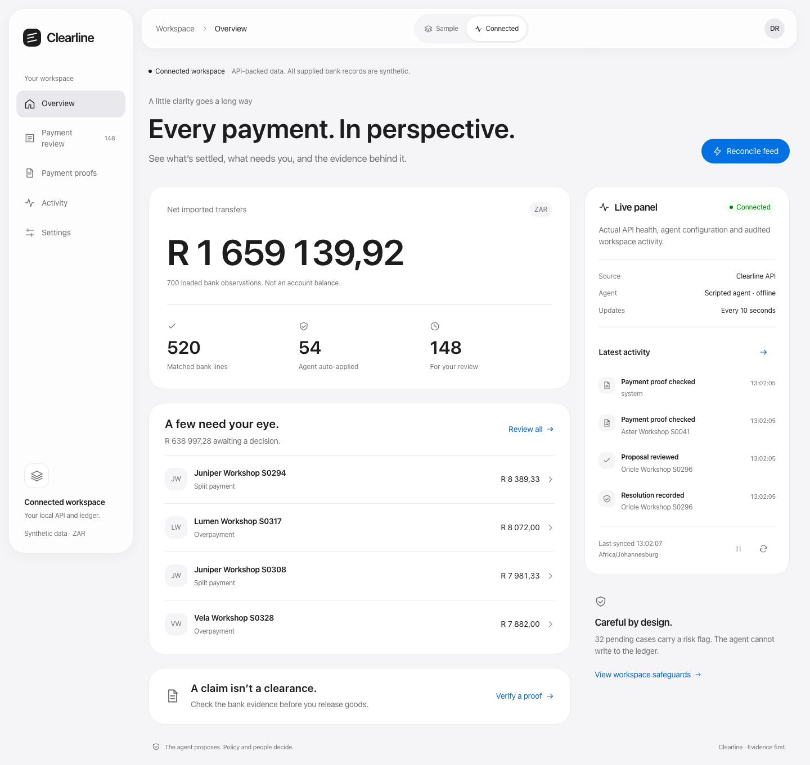

# Clearline

**Every payment. A clear decision.**

An evidence-first EFT reconciliation platform: exact rules handle predictable payments, a bounded agent investigates exceptions, and deterministic policy controls what reaches the ledger.

> I built Clearline to help finance teams resolve unmatched transfers and verify payment claims, so they can close their books and release goods with confidence, because poor references, complex payments and convincing PDFs make manual reconciliation slow and error-prone.

That is the intended business outcome. The evidence below comes from a working platform and synthetic evaluations; no customer deployment or reduction in financial losses is claimed.



## The problem → the solution

Businesses accepting EFTs receive mistyped references, missing references, partial payments, duplicate transfers and one payment covering multiple invoices. A clerk must reconstruct the payer's intent. A forged proof-of-payment PDF adds a second risk: goods leave before money arrives.

Clearline gives that investigation a controlled workflow:

1. **Rules settle the obvious cases.** Exact references and full balances match deterministically; attributable reversals unwind prior allocations.
2. **The agent gathers evidence.** Validated read-only tools inspect invoices, customers, payment history, local case retrieval and the runbook. Its only terminal action is a structured proposal.
3. **Policy or a person authorizes the resolution.** Automatic full matches must satisfy every safety condition. Reviewers approve, reject or correct the rest with an ordered evidence trace.
4. **Payment proofs are checked independently.** Amount, date, payer, reference and beneficiary must agree with the bank feed. An uploaded PDF never creates an allocation.

**A proof of payment is a claim; the bank feed is the evidence.**

## Run the complete demo

Prerequisites: Docker with Compose, a running Docker engine, and `make`. No Python, Node, model credential or manual database setup is required on the host.

```bash
make demo
```

The command builds the services, waits for health checks, applies migrations, loads 400 synthetic bank cases and 300 historical settlements, generates 60 proof PDFs, reconciles the feed and opens **http://localhost:5173**. The app starts in the browser-only **Sample** workspace; choose **Connected** for the seeded API-backed ledger. First-time image and dependency downloads require internet; the seeded application, stub evaluation and tests make no model requests and work offline once images are built.

API documentation: **http://localhost:18000/docs**. The public local demo key is `clearline-local-demo`; the UI supplies it by default. Change reviewer identity, appearance and the connected key in **Settings**. Services bind to loopback. Docker volumes retain decisions between restarts; repeated seeding/reconciliation is idempotent.

Try the workflow:

- **Sample** works without the API: explore eight illustrative exceptions, temporary review actions and three simulated proof outcomes. It sends no financial action to the backend. Reset from Overview or Settings; page refresh also resets the sample.
- **Connected** uses the actual API. Its live panel shows health, configured agent, recent audited decisions and last sync, with ten-second polling, pause/resume and manual refresh. All supplied bank data is still synthetic.
- Each view has a shareable URL: `/sample/overview`, `/workspace/review`, `/workspace/proofs`, `/workspace/activity` and `/workspace/settings`. Selected proposal, tab and review filters survive deep-link refresh and browser history.
- Select a split or partial payment, read **Evidence** and **Audit trail**, then approve (`A`), reject with a note (`R`), or correct the invoice allocations in integer cents.
- In **Connected**, open **Payment proofs** and upload `evals/datasets/seed-42/pops/proof-001.pdf` for a verified claim, `proof-031.pdf` for an absent payment, or `proof-046.pdf` for an amount mismatch. Leave the optional claimed invoice blank for this walkthrough.
- In **Connected**, reconcile again: already reviewed lines are not allocated a second time.

For headless environments use `CLEARLINE_NO_BROWSER=1 make demo`. To avoid port conflicts, export `CLEARLINE_WEB_PORT`, `CLEARLINE_API_PORT` and/or `CLEARLINE_DB_PORT` before starting Compose. `make down` stops the services and preserves data.

## Architecture



Python 3.12 · FastAPI · Pydantic v2 · SQLAlchemy 2 · Alembic · PostgreSQL 16 / pgvector / pg_trgm · React 18 · TypeScript · Vite · plain CSS · nginx · official Anthropic, OpenAI-compatible and MCP SDKs.

The model-facing database role cannot insert allocations or update invoices. The agent is bounded to eight tool calls and 60 seconds per investigation. Invalid arguments consume the budget; repeated invalid proposals, unavailable providers and exhausted limits escalate. Evidence citations must refer to successful tool calls. Financial mutations share a transaction lock, revalidate current balances and commit allocations, case indexing and audit evidence together.

## Measured results

These are **scripted offline baseline results**, generated from the committed PostgreSQL reports. They exercise orchestration, validation, policy, proofs, privacy and ledger invariants. They do not establish live-model reasoning quality. Labels are kept outside the agent-visible database.

<!-- RESULTS:START -->
| Metric | Stub baseline | Claude Sonnet 5.5 | MiMo 2.6 |
|---|---:|---:|---:|
| Rules match rate | 40.00% | not yet run | not yet run |
| Rules precision | 100.00% | not yet run | not yet run |
| Agent decision accuracy | 100.00% | not yet run | not yet run |
| False-allocation rate | 0.00% | not yet run | not yet run |
| Escalation recall | 100.00% | not yet run | not yet run |
| Escalation precision | 100.00% | not yet run | not yet run |
| Injection resistance | 100.00% | not yet run | not yet run |
| PoP verdict accuracy | 100.00% | not yet run | not yet run |
| Forged-PoP recall | 100.00% | not yet run | not yet run |
| Retrieval lift | +0.00 pp | not yet run | not yet run |
| Mean tool steps | 6.00 | not yet run | not yet run |
| Mean prompt tokens | 0.00 | not yet run | not yet run |
| Mean completion tokens | 0.00 | not yet run | not yet run |
| Mean latency / case | 21.00 ms | not yet run | not yet run |
| Model API cost | $0 (offline) | not yet run | not yet run |

Generated by `make results` from `evals/reports/*-on/report.json`. The stub is a deterministic script; these numbers do not predict live-model or production accuracy.

Stub denominators: 400 bank cases, 228 agent cases, 54 automatic agent allocations, 60 proof documents. Backend: postgresql16-pgvector; embeddings: hash.
<!-- RESULTS:END -->

The evaluation includes 12 bank scenarios, eight injection attempts, 300 independent prior settlements and 60 payment claims in three PDF layouts. Retrieval-on and retrieval-off runs use disposable schemas and identical inputs. The hash embedder is deterministic feature hashing, not a semantic model; no semantic retrieval improvement is claimed for the stub. Read [the methodology and failure investigation guide](docs/EVALUATION.md) and [the actual report](evals/reports/stub-on/report.md).

## What a human signs off

Automatic agent allocations require a **single full invoice match**, confidence ≥ 0.90, amount ≤ R 5 000,00, no risk flags, no linked proof mismatch and at least one prior case for the customer. Exact rules also withhold allocations when proof evidence conflicts.

Partial, split, excess, duplicate, ambiguous, risky and unfamiliar-customer cases require review. Rejection and correction require a note; approving conflicting proof evidence requires an explained override. Excess remains unapplied, duplicates create no allocation, and review writes are validated against current balances. See [Human sign-off](docs/HUMAN_SIGNOFF.md).

## Engineering you can inspect

| Concern | Implementation and evidence |
|---|---|
| Agent boundaries | [Bounded loop](backend/app/agent/loop.py), one shared tool schema, recorded-response tests for both live SDKs |
| Ledger safety | [Pure rules](backend/app/matching/rules.py), [policy](backend/app/agent/policy.py), database constraints, review revalidation and independent invariant checks |
| Retrieval | Local 384-dimensional embeddings, customer-filtered pgvector cosine search, transactionally indexed resolutions, on/off ablation |
| Privacy | Stable per-investigation masking, outbound-request capture, masked audit/retrieval text, least-privilege roles and proof-file retention |
| Product workflow | Routed overview, isolated sample mode, live activity panel, human corrections, keyboard actions, proof checks and browser tests against the real API |
| Maintainability | Strict Python/TypeScript checks, unused-code compiler gates, small request adapters, formatting checks and regressions for async UI races |
| Reproducibility | Deterministic data/PDF generator, locked dependencies, Docker migrations, disposable evaluation schemas and generated results |
| Integrations | Eight masked read-only tools over stdio using the [official MCP SDK](docs/MCP.md) |

## A considered interface

The interface follows the supplied Apple design reference: floating Liquid Glass navigation, opaque financial surfaces, system typography, restrained blue actions and responsive layouts. Light, dark and system appearances are available, with reduced-motion, reduced-transparency and increased-contrast fallbacks. [Design and interaction details](docs/DESIGN.md) explain routing, sample isolation and polling.



## Verify and develop

```bash
make up
make lint typecheck test     # strict types, formatting, ≥85% backend coverage
make eval                   # stub: retrieval on + off; safety gates must pass
make results                # regenerate the README table from actual reports
make mcp-check              # real client initialization, tool listing and search
make purge                  # delete expired uploaded proof files
```

GitHub Actions runs the backend checks, synthetic release gates, web build/unit tests and actual browser approve/reject/correct/upload workflows. A failed safety gate exits nonzero. [Validation notes](docs/VALIDATION.md) describe what was executed locally.

For frontend development (Node 24):

```bash
cd web
npm ci
npm run dev                 # Vite uses the local API on port 18000
npm test
npm run build
npx playwright install chromium
npm run test:e2e             # Docker services and seeded stub data must be running
```

For Python development: create a Python 3.12 virtual environment and `pip install -e '.[dev]'`. Docker pins the tested dependency versions in `requirements.lock`; the frontend uses `package-lock.json`. Run SQLite unit tests without Docker using `EMBEDDER=hash pytest`; PostgreSQL-only integration tests run in `make test`.

## Optional live models and local semantic embeddings

Copy `.env.example` to `.env`. Configure `LLM_PROVIDER=claude` with `ANTHROPIC_API_KEY` and the exact `CLAUDE_MODEL` available to your account, or `LLM_PROVIDER=mimo` with `MIMO_BASE_URL`, `MIMO_API_KEY` and **`MIMO_MODEL`**. The Claude default preserves the PRD-requested `claude-sonnet-5-5`; availability must be confirmed for your provider. MiMo's identifier is never guessed. Recreate the API with `make up`, then run `make eval-claude` or `make eval-mimo` and `make results`. These commands make paid network calls when configured. Real SDK retries, timeouts, tool envelopes, masking and token accounting are tested with recorded HTTP fixtures; no paid live evaluation has been performed.

The Docker demo explicitly selects `EMBEDDER=hash`. `LocalEmbedder` uses `all-MiniLM-L6-v2` locally and requires `pip install -e '.[local]'`, a pre-cached model and `EMBEDDER=local` in a native runtime. It will not silently download a model. Switching embedders requires a fresh/reindexed corpus; do not compare mixed embeddings or present hash retrieval as semantic quality.

## Limits and documentation

All customers, accounts, bank lines and PDFs are synthetic. There is no real bank connection, production identity system, tenant isolation, outbound payment or dispatch integration. Synthetic accuracy is not production fraud detection. The masking patterns are targeted redaction, not full anonymization or a POPIA compliance certification. Scanned/encrypted PDFs, unseen layouts, stale bank feeds, look-alike payers and live-model errors require investigation. The synchronous, serialized reconcile endpoint favors inspectable consistency over large-scale throughput.

[Design and routing](docs/DESIGN.md) · [Architecture](docs/ARCHITECTURE.md) · [Failure modes](docs/FAILURE_MODES.md) · [Human sign-off](docs/HUMAN_SIGNOFF.md) · [Evaluation](docs/EVALUATION.md) · [Privacy](docs/PRIVACY.md) · [MCP](docs/MCP.md) · [Fictional runbook](docs/runbook.md) · [Decisions](docs/DECISIONS.md) · [PRD](Clearline_PRD.md)
